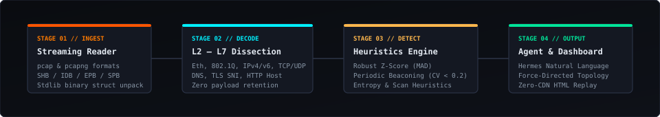
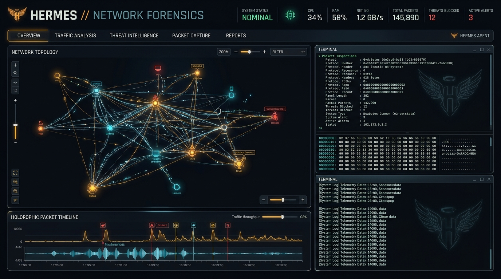

<p align="center">
  
</p>

<p align="center">
  <a href="https://github.com/NousResearch/hermes-agent"></a>
  <a href="https://nousresearch.com/"></a>
  <a href="#-architecture--pipeline"></a>
  <a href="#-security--air-gapped-sandbox"></a>
  <a href="#-license"></a>
</p>

---

<p align="center">
  
</p>

```
┌────────────────────────────────────────────────────────────────────────────────────────┐
│  NOUS RESEARCH // HERMES AGENT ECOSYSTEM                                              │
│  PROJECT      : netScope (⚚ Hermes Network Intelligence & Forensics)                   │
│  MISSION      : Swift, Deep, Air-Gapped Packet Inspection & Deterministic Anomaly Replay│
│  SECURITY     : 100% Offline • Strict CSP • Zero Cloud Egress • Zero Native Binaries   │
└────────────────────────────────────────────────────────────────────────────────────────┘
```

> *“In ancient myth, **Hermes** was the swift herald of the gods, the patron of travelers, and the guardian of boundaries who could traverse any threshold in the blink of an eye. In modern infrastructure, **netScope** equips Hermes Agent to watch over every boundary across your network — dissecting wire traffic with godlike speed and total privacy.”*

**netScope** brings deep, deterministic, and 100% offline packet capture analysis to [Hermes Agent](https://github.com/NousResearch/hermes-agent). Feed Hermes any `.pcap` or `.pcapng` file to reconstruct flows, map conversations, unmask stealthy reconnaissance, and interact with a cybernetic, self-contained visual dashboard complete with force-directed network topology and temporal traffic replay.

Pure Python standard library only. **Zero external dependencies. Zero network calls. No telemetry.**

---

## 📑 Table of Contents

- [⚚ The Hermes Paradigm](#-the-hermes-paradigm)
- [⚡ Architecture & Pipeline](#-architecture--pipeline)
- [🖥️ Interactive Dashboard Deep Dive](#-interactive-dashboard-deep-dive)
- [🚀 Quickstart Tutorial: Zero to Insights](#-quickstart-tutorial-zero-to-insights)
  - [1. Installation & Doctor Verification](#1-installation--doctor-verification)
  - [2. Generate Synthetic Capture Data](#2-generate-synthetic-capture-data)
  - [3. Instant Slash Command Analysis](#3-instant-slash-command-analysis)
  - [4. Conversational Investigation with Hermes](#4-conversational-investigation-with-hermes)
  - [5. Visualizing & Replaying Traffic](#5-visualizing--replaying-traffic)
- [🧠 Deterministic Heuristics Matrix](#-deterministic-heuristics-matrix)
- [🛠️ Tool Reference & Natural Language Integration](#-tool-reference--natural-language-integration)
- [🛡️ Security & Air-Gapped Sandbox](#-security--air-gapped-sandbox)
- [⚖️ Limits & Heuristics Disclaimer](#-limits--heuristics-disclaimer)
- [📄 License](#-license)

---

## ⚚ The Hermes Paradigm

Network forensics is frequently plagued by bloated dependencies, native C library vulnerabilities, and telemetry-laden cloud services. **netScope** redefines packet analysis by following the core philosophy of **Nous Research** and **Hermes Agent**:

| Principle | Traditional Tools (Wireshark, Zeek, SaaS) | Hermes netScope |
| :--- | :--- | :--- |
| **Dependencies** | Heavy C/C++ runtimes, libpcap, Python wheels | **Zero external dependencies** (Pure Python 3 stdlib) |
| **Privacy** | Often uploads captures to cloud APIs or queries telemetry | **100% Air-gapped**, zero network calls, zero DNS leaks |
| **Interface** | Cluttered multi-window desktop GUIs or raw text streams | **Conversational Hermes Agent** + **Single-file HTML Replay** |
| **Anomalies** | Opaque black-box ML or manual complex BPF filters | **Explainable, deterministic mathematics** (MAD, CV, Entropy) |
| **Portability** | Architecture-specific compiled binaries | Run anywhere Python 3 runs (macOS, Linux, Windows, BSD) |

---

## ⚡ Architecture & Pipeline

netScope streams packets incrementally using a memory-bounded standard library pipeline:

<p align="center">
  
</p>

1. **Multi-Format Streaming Reader (`pcap_reader.py`)**  
   Processes classic `.pcap` (microsecond & nanosecond timestamps, little/big endian) and modern `.pcapng` (SHB, IDB, EPB, SPB) formats with interface timestamp resolution. It reads raw byte structures via `struct.unpack` without loading the full file into memory.
2. **Layer 2–7 Dissector (`decode.py`)**  
   Dissects Ethernet II, 802.1Q VLAN tags, IPv4, IPv6 (with chained extension header traversal), TCP (flags, window, payload offsets), UDP, ICMP/ICMPv6, and ARP. Lightweight extraction parses DNS queries/responses, TLS Server Name Indication (SNI), and HTTP `Host` headers without persisting packet payloads.
3. **Deterministic Heuristics Engine (`heuristics.py`)**  
   Executes robust mathematical models to detect anomalous bursts (Median Absolute Deviation), horizontal/vertical port sweeps, periodic beaconing intervals (Coefficient of Variation), and DNS tunneling exfiltration (Shannon entropy).
4. **Interactive Delivery & Replay (`report.py` & `tools.py`)**  
   Feeds structured JSON context to Hermes Agent for conversational reasoning, while synthesizing a zero-CDN, standalone visual report.

---

## 🖥️ Interactive Dashboard Deep Dive

Every analysis can generate a self-contained, dark-mode HTML dashboard written to `~/.hermes/netscope/reports/`. It contains **no CDNs, no remote fonts, and no third-party scripts**, enforcing a strict Content Security Policy (`default-src 'none'`).

<p align="center">
  
</p>

<p align="center">
  
</p>

### Dashboard Systems

```
┌────────────────────────────────────────────────────────────────────────────────────────┐
│ [01] FORCE GRAPH TOPOLOGY   : Draggable nodes, auto-clustering internal vs external    │
│ [02] TEMPORAL TRAFFIC REPLAY: Scrubber controls (1x, 4x, 16x) with animated packets    │
│ [03] PROTOCOL FILTER CHIPS  : Dynamic filtering across TCP, UDP, DNS, TLS, HTTP, ICMP  │
│ [04] TRAFFIC BURST TIMELINE : 1-second bucket histogram with MAD anomaly spike markers │
│ [05] JUMP-TO-FINDING LINKS  : Instant camera focusing and timeline synchronization   │
│ [06] HOST INSPECTION DRAWER : Ingress/egress volumes, SNIs, and active peer breakdown   │
└────────────────────────────────────────────────────────────────────────────────────────┘
```

- **🌐 Force-Directed Topology**: Automatically clusters private subnets (`192.168.0.0/16`, `10.0.0.0/8`, `172.16.0.0/12`) away from external infrastructure. Nodes scale by byte volume; edges scale by total transfer weight. Nodes are physics-reactive, draggable, and clickable.
- **⏱️ Temporal Replay Engine**: Watch traffic flow in chronological order. Toggle speeds between `1x`, `4x`, and `16x` with animated particle pulses traveling along active conversation paths in real time.
- **🔍 Protocol Filter Chips**: Instant canvas filtering by protocol (`ALL`, `TCP`, `UDP`, `DNS`, `TLS`, `HTTP`, `ICMP`, `ARP`) with instantaneous graph re-weighting.
- **🎯 Finding-to-Timeline Link**: Clicking any anomaly card in the side drawer navigates the graph directly to the involved host nodes and snaps the playback scrubber to the exact occurrence timestamp.
- **📋 Host Inspection Drawer**: Deep inspection of selected endpoints displaying total ingress/egress bytes, associated DNS query names, TLS SNI certificates, active peers, and flow counts.

---

## 🚀 Quickstart Tutorial: Zero to Insights

Follow this hands-on tutorial to inspect a capture and generate your first interactive forensics dashboard in under 60 seconds.

### 1. Installation & Doctor Verification

Install netScope into your Hermes Agent environment:

```bash
# Via Hermes plugin catalog
hermes plugins install netscope
hermes plugins enable netscope
```

Or clone into your local Hermes plugins folder:

```bash
git clone https://github.com/Mxhi-04/hermes-netscope.git ~/.hermes/plugins/netscope
hermes plugins enable netscope
```

Verify your installation with Hermes Doctor:

```bash
hermes plugins doctor ~/.hermes/plugins/netscope --ci
```

```text
[✓] Hermes plugin manifests valid: plugin.yaml, SKILL.md
[✓] Zero external Python dependencies required (pure stdlib)
[✓] Stdlib struct, socket, math, json modules verified
[✓] Reports directory verified: ~/.hermes/netscope/reports
[✓] Status: HERMES NETSCOPE READY
```

---

### 2. Generate Synthetic Capture Data

netScope includes a pure Python capture synthesizer (`examples/make_sample_pcap.py`) that generates realistic, non-trivial network traffic using RFC-reserved subnets (`RFC 1918` and `RFC 5737`):

```bash
python3 examples/make_sample_pcap.py sample.pcap
```

This demo capture synthesizes:
- Baseline DNS and web browsing across 10 internal hosts.
- Rapid SYN port scan probing internal workstations.
- Periodic C2 beaconing every ~30 seconds with minimal jitter.
- High-entropy DNS tunneling queries consistent with data exfiltration.
- Sudden 400 KB traffic volume surge.

---

### 3. Instant Slash Command Analysis

Run the built-in slash command to perform a complete sweep:

```text
/netscope sample.pcap
```

Hermes immediately summarizes the traffic and generates the interactive visual report:

```text
⚚ Hermes netScope Forensics Summary: sample.pcap
────────────────────────────────────────────────────────────────────────────
Duration    : 64.20s (1,248 packets, 842.1 KB)
Endpoints   : 14 unique hosts across 42 active flows
Dominant    : TCP (68.4%), UDP/DNS (24.1%), TLS (5.2%), HTTP (2.3%)

Heuristic Observations:
  [HIGH] SYN Port Scan Detected
         Host 192.168.1.105 probed 64 unique ports on 192.168.1.10 (t=14.2s - 17.4s)
  [MED]  Periodic Beaconing
         Host 192.168.1.45 -> 198.51.100.24 every 30.1s (CV = 0.082 < 0.20 threshold)
  [MED]  High-Entropy DNS Exfiltration
         Host 192.168.1.10 made 18 queries with entropy > 4.2 bits/char (tunneling pattern)

Visual Report Generated:
file:///Users/username/.hermes/netscope/reports/sample_report.html
```

---

### 4. Conversational Investigation with Hermes

Engage Hermes in dialogue to dig into specific hosts, anomalous beacons, or TLS domain traffic:

````text
User: "Which host sent the highest volume of outbound data, and what domains did it contact?"

Hermes: [Invokes netscope_query with query="top_talkers"]
Host 192.168.1.10 was the top talker:
  • Outbound Data : 421.8 KB across 312 packets
  • Resolved SNIs : api.github.com, updates.microsoft.com
  • External DNS  : one.one.one.one (1.1.1.1)

User: "Tell me more about the beaconing detection. Why did it trigger?"

Hermes: [Invokes netscope_query with query="findings", filter_host="192.168.1.45"]
Finding #2 triggered because host 192.168.1.45 initiated 12 connections to 
198.51.100.24 with regular inter-arrival intervals:
  • Mean Interval : 30.12 seconds
  • Std Deviation : 2.47 seconds
  • Coefficient of Variation (CV) : 0.082

Because the CV is well below the 0.20 anomaly threshold, the timing exhibits 
programmatic, low-jitter beaconing characteristics consistent with automated C2 or telemetry.
````

---

### 5. Visualizing & Replaying Traffic

Open the generated HTML report in any web browser:

```bash
open ~/.hermes/netscope/reports/sample_report.html
```

1. **Topology Exploration**: Click and drag nodes to watch the spring physics settle.
2. **Filter Protocols**: Click the `DNS` chip to isolate resolver flows and tunneling queries.
3. **Trace the Attack**: Click on `[HIGH] SYN Port Scan` in the sidebar to center the camera on `192.168.1.105` and highlight its probed ports.
4. **Replay the Incident**: Hit `[ ▶ PLAY ]` at `4x` speed and watch packet pulses traverse the network as the scan and beaconing unfold chronologically.

---

## 🧠 Deterministic Heuristics Matrix

netScope deliberately avoids opaque, non-deterministic black-box models in favor of **explainable, deterministic mathematics**:

```
┌─────────────────────────┬──────────────────────────────────┬───────────────────────────────────────────┐
│ HEURISTIC               │ MATHEMATICAL MODEL               │ DETECTION THRESHOLD                       │
├─────────────────────────┼──────────────────────────────────┼───────────────────────────────────────────┤
│ Traffic Spikes          │ Robust Z-Score via MAD           │ Absolute Modified Z > 3.5 across 1s bins  │
│ Port / Host Scanning    │ Unique Dest Ports / IPs per sec  │ > 30 unique ports in < 5 seconds          │
│ Periodic C2 Beaconing   │ Coefficient of Variation (σ / μ) │ CV < 0.20 across ≥ 5 intervals            │
│ DNS Tunneling / Exfil   │ Shannon Entropy & Label Length   │ Entropy > 4.0 bits/char or labels > 45ch  │
│ Cleartext Protocols     │ Plaintext Port & Header Match    │ Telnet (23), FTP (21), HTTP basic auth    │
└─────────────────────────┴──────────────────────────────────┴───────────────────────────────────────────┘
```

### Median Absolute Deviation (MAD)
Traditional standard deviation is easily skewed by outlier bursts. netScope computes modified Z-scores using **Median Absolute Deviation**:

$$MAD = \text{median}(|X_i - \tilde{X}|)$$

$$M_i = \frac{0.6745 \cdot (X_i - \tilde{X})}{MAD}$$

Bins with $M_i > 3.5$ are flagged as statistically significant bursts.

### Beaconing Coefficient of Variation (CV)
Automated malware beacons, telemetry tasks, and C2 agents operate on programmatic sleep loops. For inter-arrival intervals $\Delta t$:

$$CV = \frac{\sigma_{\Delta t}}{\mu_{\Delta t}}$$

A sequence with $CV < 0.20$ and $\ge 5$ connections triggers a high-confidence beacon observation.

---

## 🛠️ Tool Reference & Natural Language Integration

Hermes Agent has direct access to four atomic tools registered in `plugin.yaml`:

### `netscope_analyze`
Ingests a `.pcap` or `.pcapng` file, constructs connection states, executes heuristics, and returns structured summary metrics:
```json
{
  "pcap_path": "/path/to/capture.pcap",
  "focus_host": "192.168.1.105",
  "max_packets": 2000000
}
```

### `netscope_query`
Performs in-memory queries against an existing analysis ID without re-parsing the capture:
- `query="top_talkers"`: Ranked host byte & packet metrics.
- `query="conversations"`: Peer-to-peer flows filtered by host or protocol.
- `query="dns_queries"`: DNS resolutions, question types, and response codes.
- `query="tls_hosts"`: Extracted SNIs and certificate hostnames.
- `query="findings"`: Filtered list of heuristic anomaly records.

### `netscope_visualize`
Generates the self-contained HTML dashboard with embedded JSON data, canvas topology, and timeline replay:
```json
{
  "analysis_id": "ns_a1b2c3d4e5f6",
  "focus_host": "192.168.1.10"
}
```

---

## 🛡️ Security & Air-Gapped Sandbox

netScope is purpose-built for sensitive enterprise, security operations, and air-gapped forensic environments:

- **🔒 Zero Network Egress**: Makes no socket connections, no telemetry beacons, and no external DNS lookups.
- **🧱 Strict Content Security Policy**: Generated reports enforce `default-src 'none'; script-src 'unsafe-inline'; style-src 'unsafe-inline'; img-src data:`. No scripts or stylesheets can ever load from external origins.
- **🧹 Sanitized Dissection**: All packet-derived metadata (DNS domain labels, TLS SNI headers, HTTP hosts) is strictly sanitized against control characters and length-truncated prior to display.
- **🚫 Zero Payload Retention**: Raw packet payloads are never persisted in memory or written into HTML reports. Only structural protocol headers and metadata are analyzed.

---

## ⚖️ Limits & Heuristics Disclaimer

### Engine Boundaries
- **Default File Cap**: 256 MB soft limit per capture.
- **Default Packet Cap**: 2,000,000 packets per stream.
- **Graph Node Cap**: The visual topology graph renders the top 300 active hosts to ensure 60fps canvas performance; remaining hosts are grouped into aggregate metrics.

### Heuristics are Observations, Not Verdicts
> Anomaly flags represent patterns consistent with specific network behaviors (e.g., automated scanning or periodic polling). Benign software, vulnerability scanners, health check monitors, NTP synchronizations, and misconfigured services frequently display identical traffic profiles. Always correlate netScope findings with endpoint logs, auth logs, and host-level telemetry.

---

## 📄 License

Distributed under the **MIT License**. See [LICENSE](LICENSE) for details.

Developed with open intelligence for the [Hermes Agent](https://github.com/NousResearch/hermes-agent) ecosystem by [Nous Research](https://nousresearch.com/).
