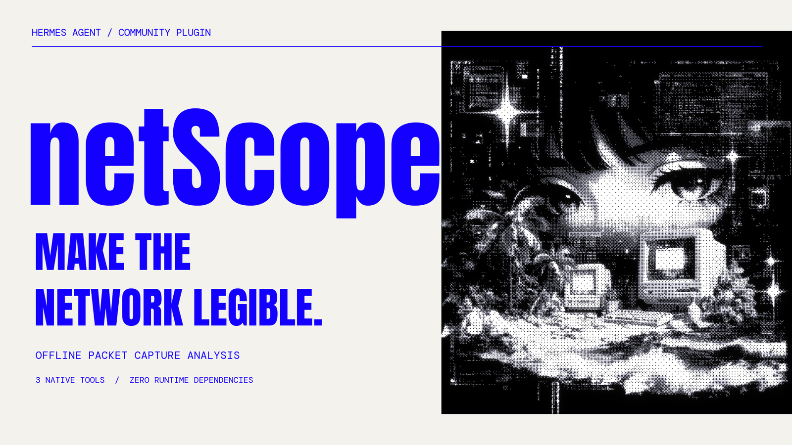
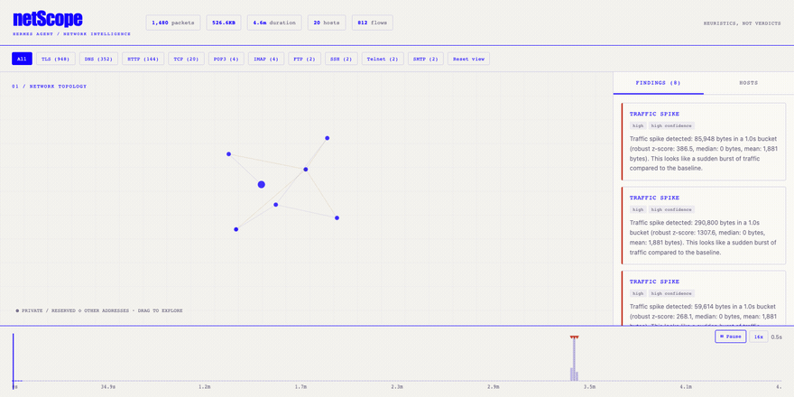
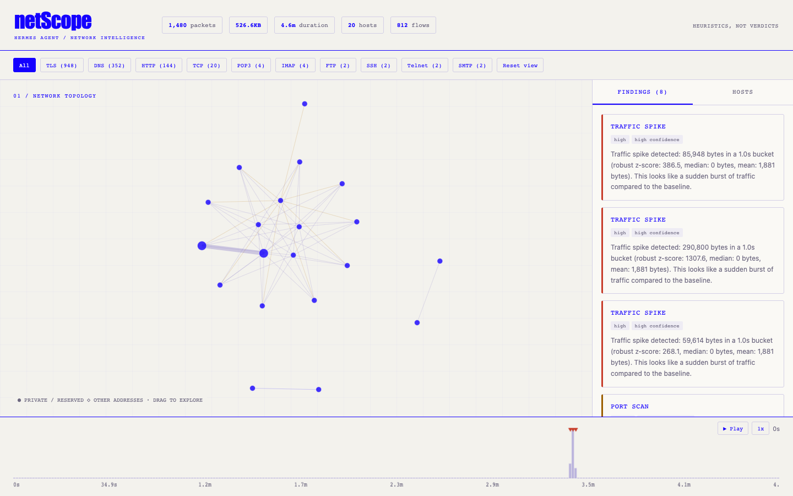
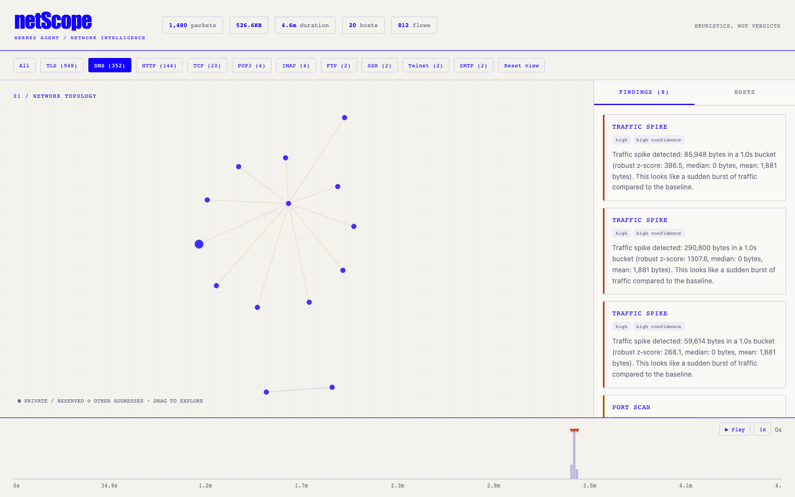
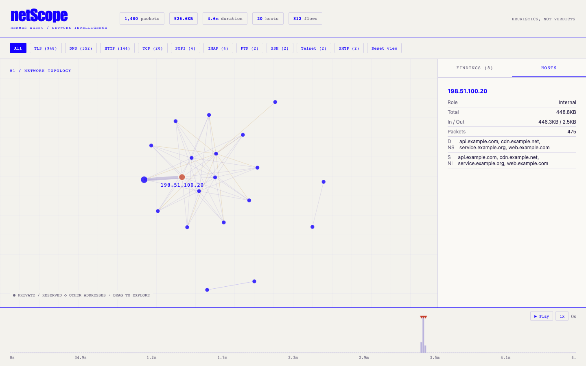
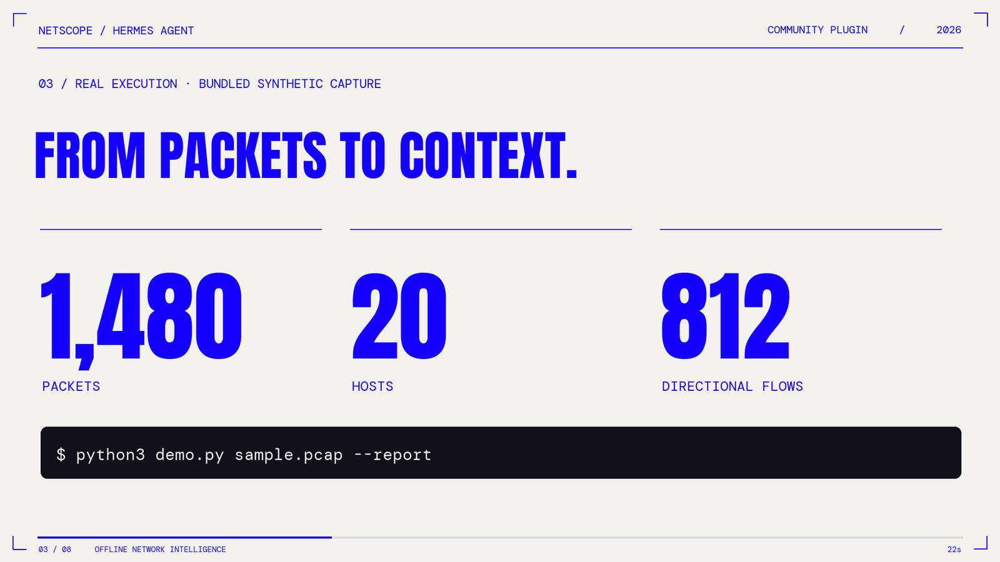
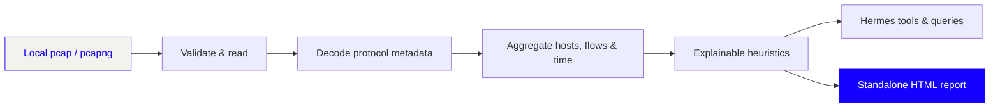

<div align="center">

<a href="https://nousresearch.com/"></a>

<br>

<p><strong>A COMMUNITY PLUGIN FOR HERMES AGENT</strong></p>



<h3>Turn a packet capture into a conversation.</h3>

<p>Local <code>.pcap</code> and <code>.pcapng</code> analysis. Explainable findings. An interactive report you can keep.</p>

<a href="LICENSE"></a>


<a href="docs/AUDIT.md"></a>

<br><br>

<p><a href="#quick-start">Quick start</a> &nbsp; / &nbsp; <a href="assets/netscope-demo.mp4">Watch the film</a> &nbsp; / &nbsp; <a href="#three-tools-one-investigation">Tools</a> &nbsp; / &nbsp; <a href="docs/AUDIT.md">Audit</a></p>

</div>

---

## See the signal.

An unfamiliar connection. A sudden burst. A DNS pattern that deserves a second look. **netScope gives Hermes structured evidence to investigate them**: hosts, directional flows, conversations, protocol totals, and time buckets.

Analysis runs on your machine. The plugin makes no network requests and needs no third-party Python packages. The model you use with Hermes still follows your chosen provider’s data policy; capture-derived metadata returned to Hermes can enter that conversation.

<div align="center">

<br>
<sub>Actual plugin output · bundled synthetic traffic · no production capture data</sub>
</div>

## Built for the investigation.

| Capability | What you get |
| :-- | :-- |
| **Read the capture** | Classic pcap in both byte orders, microsecond and nanosecond timestamps; pcapng sections, interfaces, timestamp resolution and offset. |
| **Follow connections** | IPv4 and IPv6 hosts, directional five-tuple flows, bidirectional IP conversations, top talkers, and protocol totals. |
| **Find a starting point** | Deterministic heuristics for traffic bursts, scan-like patterns, periodic connections, unusual DNS labels, many subdomains, and ports associated with cleartext protocols. |
| **Ask follow-ups** | Seven structured query types over a cached analysis, without reading the capture again. |
| **Explore locally** | A standalone HTML report with a draggable topology, protocol filters, host inspection, finding selection, and traffic replay at 1×, 4×, or 16×. |

## The report, in focus.



<table>
<tr>
<td width="50%"><p><b>Isolate a protocol.</b><br><sub>Reduce the topology to conversations carrying the selected protocol.</sub></p></td>
<td width="50%"><p><b>Inspect an endpoint.</b><br><sub>Read observed names, traffic volume, protocol counts, and related findings.</sub></p></td>
</tr>
</table>

### A 69-second introduction.

[](assets/netscope-demo.mp4)

**[Watch or download the 1080p film →](assets/netscope-demo.mp4)** · [Captions](assets/demo-captions.srt) · [Storyboard](assets/demo-storyboard.jpg)

Original motion graphics, real report captures, and female narration generated with Sarvam Bulbul v3. Nous Research’s logo appears at the opening and closing. GitHub links the committed MP4 as a file; the GIF above plays directly in the README.

## Quick start

### Run the real tools locally

Python **3.11+** is recommended to match current Hermes. The analyzer itself uses only the standard library.

```bash
git clone https://github.com/Mxhi-04/Hermes-netscope.git
cd Hermes-netscope
python3 examples/make_sample_pcap.py sample.pcap
python3 demo.py sample.pcap --report
```

The demo calls the same handlers registered with Hermes. It prints JSON and writes the report under `$HERMES_HOME/netscope/reports/`, or `~/.hermes/netscope/reports/` when `HERMES_HOME` is unset. Open the returned `report_path` in a browser.

**Observed output from the bundled capture, seed 42:**

```text
Packets          1,480
Wire bytes       526,635
Hosts            20
Directional flows 812
Conversations    53
Duration         278.957 seconds
```

The synthetic fixture deliberately contains scan-like probes, periodic connections, unusual DNS queries, bursts, and ports associated with cleartext protocols. It demonstrates the detectors; it is not an accuracy benchmark.

### Use it with Hermes

Install directly from this repository; catalog acceptance is a separate review.

```bash
hermes plugins install Mxhi-04/Hermes-netscope
hermes plugins enable netscope
```

Then, in Hermes:

```text
/netscope /absolute/path/to/capture.pcap
```

Paths containing spaces can be quoted. Example follow-ups:

> Which hosts transferred the most data?<br>
> Show me the conversations involving 192.168.1.55.<br>
> Explain the periodic connection finding and generate a report focused on that host.

For a local development checkout, validate with the current [Hermes plugin tooling](https://hermes-agent.nousresearch.com/docs/developer-guide/plugins/):

```bash
hermes plugins doctor . --ci
hermes plugins validate .
```

## Three tools. One investigation.

| Tool | Input | Result |
| :-- | :-- | :-- |
| `netscope_analyze` | `pcap_path`, optional `max_packets` | Summary, warnings, compact findings, and an `analysis_id`. |
| `netscope_query` | `analysis_id`, `query`, query-specific arguments | Structured answers from the cached analysis. |
| `netscope_visualize` | `analysis_id`, optional `focus_host`, `protocol`, `start`, `end` | An absolute path to a self-contained HTML report. Time bounds are Unix timestamps. |

```python
import json
from tools import handle_analyze, handle_query, handle_visualize

analysis = json.loads(handle_analyze("sample.pcap"))
assert analysis["ok"], analysis
analysis_id = analysis["analysis_id"]

print(handle_query(analysis_id, "top_talkers", n=5, by="bytes"))
print(handle_query(analysis_id, "findings"))
print(handle_visualize(analysis_id, focus_host="192.168.1.55"))
```

Run this example from the cloned repository. Keep follow-up calls in the same process: the cache holds the five most recent analyses and is cleared on restart.

<details>
<summary><b>All seven query types</b></summary>

| Query | Arguments | What it answers |
| :-- | :-- | :-- |
| `top_talkers` | `n`, `by="bytes"` or `"packets"` | Which endpoints dominate the capture? |
| `host_detail` | `ip` | What traffic and conversations involve this host? |
| `conversations` | `n` | Which bidirectional IP pairs carry the most bytes? |
| `protocol_breakdown` | — | How many packets and bytes belong to each protocol label? |
| `time_window` | `start`, `end` | Which aggregate timeline buckets overlap these Unix timestamps? |
| `findings` | — | What patterns triggered, and why? |
| `dns_names` | — | Which endpoint names were observed via SNI or HTTP Host? |

`n` accepts 1–1,000. DNS question names are not treated as DNS answer-to-IP mappings. Protocol names are lightweight classifications, often based on ports.

</details>

## From bytes to context.



The plugin registers **three tools, one slash command, and one bundled skill** through public Hermes APIs. No hooks, middleware, core patches, model overrides, or telemetry.

## Privacy, with visible limits.

- **Local file access.** The plugin can read the capture path you supply. Analysis leaves the source file unchanged and writes a report only when requested.
- **Limited metadata extraction.** DNS question names, TLS ClientHello SNI, HTTP Host headers, and SSH banners can be read. Credentials and packet bodies are not extracted into reports; raw packet buffers are released after decoding.
- **Sensitive reports.** Hostnames, addresses, and traffic metadata may still be private. Reports are written atomically with owner-only file permissions on systems that support them.
- **Untrusted strings.** Capture-derived names remain data. Embedded report JSON escapes HTML delimiters, and capture text is displayed through text nodes. The report blocks external resources with a Content Security Policy.
- **Finite resources.** Defaults: 256 MiB file size, 2,000,000 packets, and a 30-second **reader** budget. This is not an end-to-end timeout or a constant-memory parser; memory grows with packets, hosts, and flows. The graph shows at most 300 hosts.
- **Lightweight inspection.** No TCP stream reassembly, IP fragment reassembly, TLS decryption, checksum validation, full Wireshark dissection, or packet-exact replay. Replay shows conversation lifetimes and aggregate time buckets. pcapng simple packets lack timestamps and are excluded from timed analysis.
- **Heuristics need context.** Periodic retries, legitimate scanners, health checks, and unusual domains can trigger findings. Protocol ports do not establish encryption status. A quiet result is not a security guarantee.

## Tested where it matters.

The audit added regression coverage for corrupt captures, protocol boundaries, false-positive scans, time buckets, unsafe strings, package isolation, and error handling. Current Hermes’s Plugin Doctor, catalog admission validator, and real registry dispatch were also exercised.

**[Read the audit and evidence →](docs/AUDIT.md)** · [Catalog validation](docs/catalog-validation.json) · [Runtime validation](docs/runtime-validation.json)

```bash
python3 -m venv .venv
# macOS / Linux
source .venv/bin/activate
# Windows PowerShell: .venv\Scripts\Activate.ps1
python -m pip install -r requirements-dev.txt
python -m pytest -q
python -m ruff check . --select F
```

CI is configured for Linux, macOS, and Windows on Python 3.11 and 3.13. Local validation results and untested environments are recorded in the audit.

## Credits & visual references

Built by **Mxhi-04** for the [Hermes Agent](https://github.com/NousResearch/hermes-agent) ecosystem. This is an independent community project; it is not an official Nous Research plugin or an endorsement.

The visual direction follows [Nous Research](https://nousresearch.com/): electric blue, warm paper, emphatic typography, and engraved artwork. The motion references include MotionVideo’s [kinetic type](https://motionvideo.xyz/videos/shneural-2abdfa), [shape morphing](https://motionvideo.xyz/videos/twoclipping-5cba86), [feature teaser](https://motionvideo.xyz/videos/utsavchopra30-50540b), and [engraving-style](https://motionvideo.xyz/videos/lexnlin-038035) examples. These are design references; their videos are not incorporated into this project.

[Media provenance, typography licenses, and reproduction notes →](docs/MEDIA.md)

[MIT](LICENSE) applies to the project code. Nous logos and artwork retain their respective rights and are credited separately. Bundled fonts carry their SIL Open Font Licenses.

<div align="center">
<br>
<a href="https://nousresearch.com/"></a>
<br><br>
<sub>LOCAL ANALYSIS. CLEARER ANSWERS.</sub>
</div>
